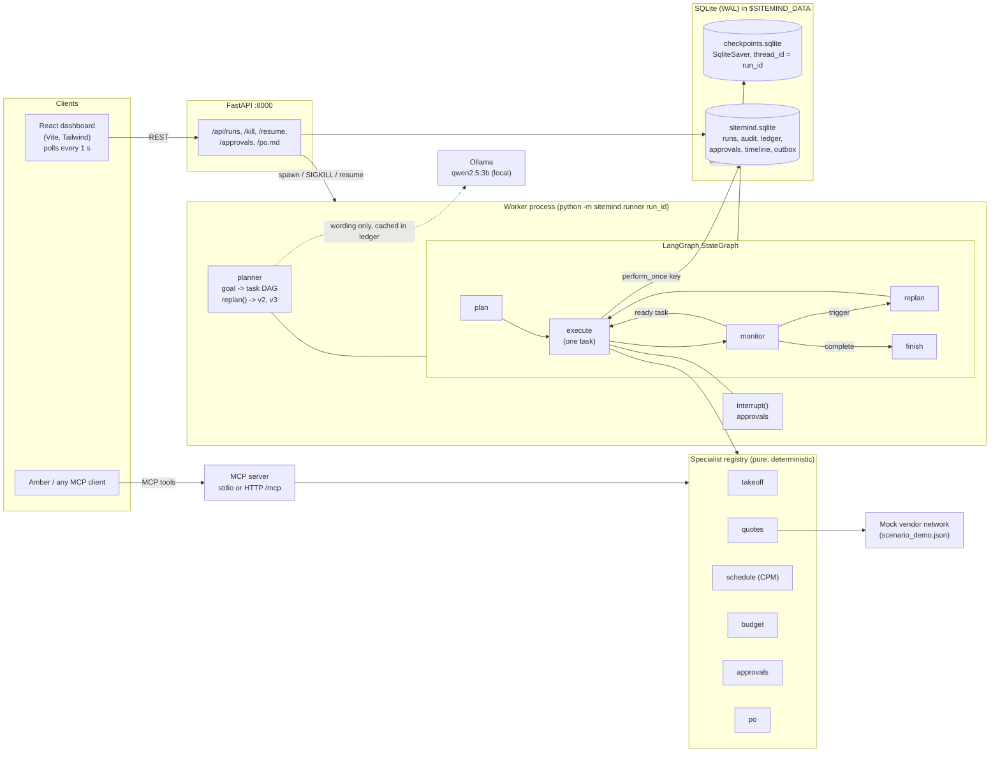

# SiteMind

**A durable procurement agent for construction. Give it one goal in plain English; it plans the job, calls specialist agents, survives `kill -9`, never sends the same RFQ or PO twice, and stops for a human before anything that cannot be undone.**

[](LICENSE)


> Entry for **"The Dawn of Superintelligence | Kaya AI Grand Challenge"**, Edition 2 — Students division.
> **Track 01: Amber General Intelligence (AGI)**, challenge **1.3 "Work that takes days, not minutes"**.
> The same run also demonstrates the **1.2 "The conductor: orchestrating specialist agents"** pattern.

> **All vendors, prices and project data in this repository are synthetic.** Voltaris Switchgear
> Pvt Ltd, Kestrel Power Systems and Anvil Electric India are fictional mock vendors written for
> the demo. See [Limitations](#limitations) and [`CREDITS.md`](CREDITS.md).

---

## The problem

On a data-centre job, long-lead electrical gear sets the schedule. A 480 V switchgear package
typically carries a 4 to 6 month lead time, and energisation cannot start without it.

Procurement for that package runs for weeks across email and Excel: a takeoff from the spec,
RFQs to several vendors, chasing the ones that go quiet, re-checking prices that move after
the quote, comparing lead times against the required-on-site date, getting two sign-offs,
and issuing the PO. One missed date slips energisation. One duplicated email or order costs
money and credibility.

The work is not hard to describe. It is hard to *stay with* for weeks without dropping a
step or doing one twice.

## What SiteMind does

Demo job: **Project Alpha**, a 24 MW Tier-III data centre at Chakan MIDC, Pune.

Goal, as typed: *"Get the 480 V switchgear package for Project Alpha ordered by 2027-03-15
within budget ₹4.6 Cr."*

| Step | What happens |
|---|---|
| 1. Goal | One sentence plus a need-by date and a budget ceiling (₹4,60,00,000). |
| 2. Plan | The planner builds a 14-task dependency DAG with deadlines, cost allowances and 5 risks. The structure is deterministic; the local model words the rationale. |
| 3. Specialists | Each task is dispatched to a registered specialist: takeoff, quotes, schedule (CPM), budget, approvals, PO. |
| 4. Durable execution | One task per LangGraph super-step, one SQLite checkpoint per task. Every side effect goes through an idempotency ledger. |
| 5. Monitor and re-plan | After each task a monitor checks the facts. A budget breach, a broken deadline, a silent vendor or a rejected approval produces plan v2, v3, … |
| 6. Human in the loop | Vendor selection and PO release are `interrupt()` points. The agent writes a ranked decision memo and waits. |
| 7. PO | Draft PO package (Markdown), second approval, then the PO is sent exactly once. |

Every step writes an audit entry (actor, action, reasoning summary, inputs, outputs, cost,
confidence, plan version) and the takeoff cites the PDF page, table and row for each line.

## Architecture



Source layout:

| Path | Purpose |
|---|---|
| `backend/sitemind/models.py` | Pydantic v2 contract for every data shape |
| `backend/sitemind/planner.py` | Goal to plan DAG, `replan()` |
| `backend/sitemind/graph.py` | LangGraph state machine, task handlers, trigger detection |
| `backend/sitemind/store.py` | App DB: runs, audit, ledger (`perform_once`), approvals, timeline, outbox |
| `backend/sitemind/clock.py` | Simulated clock, persisted per run |
| `backend/sitemind/llm.py` | Ollama / OpenAI-compatible / off, with deterministic fallback |
| `backend/sitemind/specialists/` | Specialists and `registry.py` |
| `backend/sitemind/mcp_server.py` | MCP server exposing the specialists |
| `backend/sitemind/runner.py` | Worker process (`python -m sitemind.runner <run_id>`), kill / resume / approve services |
| `backend/sitemind/api.py` | FastAPI app `sitemind.api:app` |
| `backend/sitemind/cli.py` | Headless demo: `python -m sitemind.cli demo` |
| `frontend/` | React 18 + Vite + TypeScript + Tailwind dashboard |
| `demo/` | Automated demo-video pipeline (`demo/script.yaml`) |

More detail: [`docs/ARCHITECTURE.md`](docs/ARCHITECTURE.md), [`docs/CONTRACT.md`](docs/CONTRACT.md),
[`docs/SPECIALISTS.md`](docs/SPECIALISTS.md).

## How durability and idempotency work

**1. One checkpoint per task.** The run is a LangGraph `StateGraph` compiled with `SqliteSaver`
(`thread_id = run_id`, file `$SITEMIND_DATA/checkpoints.sqlite`). Each super-step executes
exactly one plan task, so the plan, the facts and the simulated time are persisted after every
task.

**2. A ledger in front of every side effect.** RFQs, quote refreshes, negotiation messages,
PM notifications, approval requests, PO transmission and LLM calls all go through
`store.perform_once(key, kind, payload, fn)`. The key is the primary key of the `ledger` table
(unique), with the format:

```
{run_id}:{task_id}:{action}:{discriminator}

<run_id>:T2-rfq:rfq:V1:a2             RFQ to vendor V1, attempt 2
<run_id>:T3-levelling:refresh:V2:r1   refresh of V2's revision-1 quote
<run_id>:T11-approve-vendor:approval:requested
<run_id>:T14-send-po:po:<po_number>   PO transmission
<run_id>:plan-v1:llm:rationale        cached model output
```

- Key absent: claim it, run `fn`, store the result.
- Key present and done: return the stored result and increment `executions`. `fn` does not run.
- Key claimed by a process that has died: the new worker takes the claim over and runs it.

`executions` counts how many times an action was *requested*. The dashboard's Audit tab shows
`×2` beside a ledger entry that was requested by one worker and again by the worker that
resumed, and was executed once.

**3. `interrupt()` for approvals.** The approval row is created through `perform_once`, then
the node calls LangGraph `interrupt()`. The worker exits. When a person decides in the
dashboard, the API stores the decision and starts a worker that resumes the graph with
`Command(resume=decision)`.

**4. `kill -9`, then resume.** The worker is a separate OS process
(`python -m sitemind.runner <run_id>`) whose pid is stored in the `runs` table.
`POST /api/runs/{id}/kill` sends SIGKILL. `POST /api/runs/{id}/resume` starts a new worker that
continues from the latest checkpoint.

**5. Why nothing is duplicated.** The interrupted task is replayed from its start, which is
safe for three reasons:

- specialists are pure functions, so the replay recomputes the same values;
- each side effect inside the task hits the ledger and returns the stored result;
- audit and timeline rows carry deterministic dedupe keys (`UNIQUE`), so replays do not add rows.

The mock vendor `outbox` table records each message actually delivered, with the sending pid,
so the claim can be checked independently of the ledger.

**6. Controllable simulated clock.** The job spans weeks of simulated time and about a minute
of wall time. Simulated time lives in the checkpointed state and is mirrored to the `runs`
row, so a replayed node lands on the same instant. Sim start is 2027-01-11 09:00 IST.
`SITEMIND_STEP_DELAY` sets wall-clock pacing per step (0 by default, 1.5 s in Docker).

## Specialist registry

Defined in `backend/sitemind/specialists/registry.py`, served at `GET /api/registry` and by the
MCP tool `list_specialists`.

| Specialist | Takes | Returns | MCP tool | Deterministic | Side effects |
|---|---|---|---|---|---|
| `planner` | Goal, run facts | `Plan` (task DAG, risks) | `list_specialists` | structure yes, wording by LLM | no |
| `takeoff` | spec PDF path | `TakeoffResult` (lines with source, confidence, warnings) | `takeoff_from_pdf` | yes | no |
| `quotes` | takeoff lines, vendor ids, sim time, scenario | `QuotesResult` (quotes, per-attempt log) | `request_vendor_quotes` | yes | yes (RFQ, ledgered) |
| `schedule` | quote or lead time, PO date, required-on-site date | `ScheduleResult` (CPM activities, critical path, float) | `compute_schedule` | yes | no |
| `budget` | quote, budget, contingency %, expedite fee | `BudgetCheck` (ok / warn / breach) | `check_budget` | yes | no |
| `approvals` | quotes, schedules, budget checks, expedite offers | `VendorOption[]`, `DecisionMemo` | `rank_vendor_options` | yes (prose optional) | no |
| `po` | goal, chosen option, quote, takeoff | `PurchaseOrder` (+ Markdown package) | `draft_purchase_order` | yes | yes (send, ledgered) |

Ranking score (0 to 1): `0.40 × cost headroom + 0.35 × schedule float + 0.25 × reliability`.
A budget breach or a late delivery makes an option infeasible, and an infeasible option is
never recommended.

## MCP server

Every specialist is callable by another agent through the official MCP Python SDK.

| Tool | Arguments | Returns |
|---|---|---|
| `list_specialists` | none | the registry (inputs, outputs, flags per specialist) |
| `takeoff_from_pdf` | `pdf_path?` (defaults to the sample spec) | `TakeoffResult` |
| `request_vendor_quotes` | `vendor_ids?`, `scenario`, `now`, `max_attempts`, `refresh` | quotes and attempts |
| `compute_schedule` | `lead_time_days`, `po_issue_date`, `required_on_site`, `vendor_id` | `ScheduleResult` |
| `check_budget` | `quote`, `budget_inr`, `contingency_pct`, `expedite_fee_inr` | `BudgetCheck` |
| `rank_vendor_options` | `scenario`, `po_issue_date`, `required_on_site`, `budget_inr`, `refreshed` | options, memo, attempts, schedules, budgets |
| `draft_purchase_order` | `option_id?`, `scenario`, `po_number`, `po_issue_date`, … | `PurchaseOrder` |

The tools are stateless and return structured JSON. Tools that need quotes re-derive them from
the named scenario.

Run it (after `pip install -e backend`):

```bash
python -m sitemind.mcp_server                      # stdio
python -m sitemind.mcp_server --http --port 8765   # streamable HTTP at http://127.0.0.1:8765/mcp
```

Client config (Claude Desktop, Cursor, or any client that reads an `mcpServers` block):

```json
{
  "mcpServers": {
    "sitemind": {
      "command": "python",
      "args": ["-m", "sitemind.mcp_server"]
    }
  }
}
```

Use the Python interpreter of the environment where `sitemind` is installed (for example
`/path/to/sitemind/.venv/bin/python`). Claude Code:

```bash
claude mcp add sitemind -- python -m sitemind.mcp_server
```

## Setup

### Docker (3 commands)

```bash
git clone https://github.com/<your-username>/sitemind
cd sitemind
docker compose up --build
```

Open <http://localhost:8000>. The first start pulls the `qwen2.5:3b` model (about 1.9 GB) into
a Docker volume.

### Without Docker (3 commands)

Requires Python 3.11+, Node 22, and [Ollama](https://ollama.com).

```bash
git clone https://github.com/<your-username>/sitemind
cd sitemind
scripts/dev.sh
```

`scripts/dev.sh` installs the backend (`pip install -e "backend[dev]"`), builds the dashboard,
starts Ollama if needed, pulls the model and serves on <http://localhost:8000>. To run with no
model at all, use `SITEMIND_LLM_PROVIDER=off scripts/dev.sh` (deterministic templates only).

`make help` lists the same steps as targets (`make dev`, `make run`, `make test`, `make docker-up`).

### Try it

1. Open <http://localhost:8000> and press **Launch agent** (the Project Alpha goal is prefilled).
2. On **Overview**, watch the task graph, vendor table and budget. V1 times out twice, V2
   revises its price, the plan moves to v2.
3. Press **Kill worker** while the run is in progress, then **Resume**.
4. Open the **Audit** tab and look at the ledger: every key appears once, and entries
   requested more than once are marked `×2`.
5. Open **Approvals**, read the decision memo, approve. Approve the PO release. Open the **PO** tab.

The same job from a terminal, with a SIGKILL and resume in the middle and approvals
auto-accepted (run from `backend/`):

```bash
python -m sitemind.cli demo --provider off --kill-after 12
```

### Configuration

| Variable | Default | Meaning |
|---|---|---|
| `SITEMIND_LLM_PROVIDER` | `ollama` | `ollama`, `openai` (any OpenAI-compatible endpoint), or `off` |
| `SITEMIND_LLM_MODEL` | `qwen2.5:3b` | model name |
| `OLLAMA_BASE_URL` | `http://localhost:11434` | Ollama endpoint |
| `OPENAI_API_KEY`, `OPENAI_BASE_URL` | unset | used when the provider is `openai` |
| `SITEMIND_DATA` | `backend/.data` | directory for both SQLite files |
| `SITEMIND_STEP_DELAY` | `0` | wall-clock seconds per agent step |

## Tests

```bash
make test        # = cd backend && SITEMIND_LLM_PROVIDER=off python3 -m pytest
make lint        # ruff + mypy
```

The suite is deterministic and needs no model. It covers the specialists (takeoff, vendor
network, CPM schedule, budget, ranking and memo, PO), the planner and re-plan rules, the
store and `perform_once`, the graph, kill-and-resume durability, the API and the MCP server.
Tests marked `llm` call a real local model and are skipped when Ollama is unreachable.

<!-- TODO verify: state the final test count (60 passed, 1 deselected at the time of writing; tests were still being added) and add the Playwright e2e command once e2e/ has a spec file -->

## Demo numbers

Figures below come from the deterministic `demo` scenario and are reproduced by the unit tests.
Reference basis: budget ₹4,60,00,000, required on site 2027-07-30, reference PO date
2027-01-20, money ex-GST. Full tables: [`docs/SPECIALISTS.md`](docs/SPECIALISTS.md).

**Takeoff.** 8 line items read from sheet 4 of the spec PDF and cross-checked against the
single-line diagram. Confidence 0.92. One warning: the schedule lists 4 surge protection
devices and the drawing shows 3, so the agent uses the schedule quantity and raises an RFI.

**RFQ.** V1 Voltaris times out on attempts 1 and 2 and answers on attempt 3. V2 and V3 answer
first time.

| Quote | Total (ex-GST) | Lead time |
|---|---:|---:|
| V1 Voltaris | ₹3,54,75,400 | 140 d |
| V2 Kestrel | ₹3,86,51,400 | 112 d |
| V3 Anvil | ₹3,72,58,400 | 168 d |

**Price revision.** On refresh, V2 adds an 11 % raw-copper surcharge and withdraws its 3 %
early-order discount. The quote rises to ₹4,41,66,800 (+14.3 %). With 5 % contingency the
commitment is ₹4,63,75,140, which is 100.8 % of budget: a breach of ₹3,75,140.

**Ranking after re-plan v2.**

| Option | Committed | Budget use | Delivery | Float | On-time record | Score | Result |
|---|---:|---:|---|---:|---:|---:|---|
| O-V3X Anvil, expedited | ₹4,17,21,320 | 90.7 % (warn) | 2027-07-01 | +29 d | 0.90 | 0.654 | **recommended** |
| O-V1 Voltaris | ₹3,72,49,170 | 81.0 % (ok) | 2027-07-15 | +15 d | 0.82 | 0.579 | feasible |
| O-V2 Kestrel, rev 2 | ₹4,63,75,140 | 100.8 % (breach) | 2027-06-17 | +43 d | 0.93 | 0.542 | infeasible |
| O-V3 Anvil, standard | ₹3,91,21,320 | 85.0 % (ok) | 2027-08-12 | −13 d | 0.90 | 0.406 | infeasible |

The memo puts the trade-off to the project manager: O-V1 is ₹43.8 L cheaper; O-V3X pays a
₹26 L expedite fee for 14 more days of float and a better on-time record. The human can pick
either.

**PO totals (incl. 18 % GST).** O-V3X Anvil ₹4,70,32,912. O-V1 Voltaris ₹4,18,60,972.

### What the live run shows

The reference table above fixes the PO date at 2027-01-20. In a live run the PO date is
projected from the simulated clock, which by then has absorbed two vendor timeouts, bid
levelling and a 4-day negotiation, so every option has less float. Figures from
`python -m sitemind.cli demo --provider off --kill-after 12`:

| At the decision memo (sim 2027-01-29) | Delivery | Float | Budget | Result |
|---|---|---:|---|---|
| O-V3X Anvil, expedited | 2027-07-24 | +6 d | warn (90.7 %) | **recommended, the only feasible option** |
| O-V2 Kestrel, rev 2 | 2027-07-10 | +20 d | breach (100.8 %) | infeasible |
| O-V1 Voltaris | 2027-08-07 | −8 d | ok (81.0 %) | infeasible (late) |
| O-V3 Anvil, standard | 2027-09-04 | −36 d | ok (85.0 %) | infeasible (late) |

| Run outcome | Value |
|---|---|
| Plan | v2, 18 tasks: 17 done, 1 superseded |
| PO | `PO-ALPHA-20270207-V3-01` to Anvil Electric India, ₹3,98,58,400 ex-GST, ₹4,70,32,912 incl. GST |
| PO sent | sim 2027-02-10, 33 days ahead of the 2027-03-15 need-by date |
| Delivery after PO acknowledgement | 2027-07-22, +8 d float against 2027-07-30 |
| Simulated duration | 30 days |
| Checkpoints / audit entries / ledger keys | 39 / 36 / 17 |
| Worker restarts | 1 (SIGKILL during `T3-levelling`, resumed from checkpoint 7) |
| RFQs delivered | 5 (V1 ×3 attempts, V2 ×1, V3 ×1), each once |
| POs delivered | 1 |
| Wall time, templates only, no pacing | 5.4 s |

The memo states the risk plainly: 6 days of float is thin, the option sits above the 90 %
budget warning line, and the ₹26 L expedite fee should be payable only against a contractual
delivery milestone with LDs.

## Models, cost and response time

| Item | Value |
|---|---|
| Model | Qwen2.5-3B-Instruct (`qwen2.5:3b`) served locally by Ollama, temperature 0 |
| Used for | plan rationale, risk mitigations, re-plan summary, decision-memo prose |
| Not used for | quantities, prices, dates, scores, verdicts (all deterministic code) |
| Cost per run | ₹0 in API fees; runs on a laptop CPU |
| Calls per run | 3 (plan rationale, re-plan explanation, memo prose) |
| Response time | 5.4 s wall for the full run with `SITEMIND_LLM_PROVIDER=off`. With `qwen2.5:3b` on CPU: <!-- TODO verify: measure seconds per LLM call and total wall time per run with Ollama --> |
| If the model is unreachable | deterministic template; the audit entry records `provider: "fallback"` |

Each model call is cached in the ledger, so a resumed run does not call the model again.
The Qwen2.5-3B weights are under the Qwen Research License (non-commercial). For commercial
use set `SITEMIND_LLM_MODEL` to an Apache-2.0 size such as `qwen2.5:7b`.

## Limitations

- **Synthetic vendors and prices.** The three vendors, their prices, lead times and failure
  behaviour are authored for the demo. Nothing here is a real quotation.
- **Simulated clock.** Days pass in a simulated calendar. Vendor replies and human turnaround
  times are scripted by the scenario file.
- **Small local model, prose only.** The 3B model words rationales and memos. It does not
  plan structure or do arithmetic, and it can be switched off without changing any number.
- **No real email or ERP integration.** RFQs and POs go to a mock outbox table. Sending real
  mail or posting to an ERP needs adapters behind the same `perform_once` call.
- **Idempotency boundary.** A completed action is never repeated. If a worker dies after an
  external effect and before the ledger row is marked done, the action is retried; a real
  integration must pass the idempotency key to the receiving system so it can deduplicate.
- **One package type, one spec format.** The takeoff parser reads the equipment-schedule
  table of the sample spec. Other document layouts need their own extractor.
- **Single-tenant.** No authentication, no user roles, one SQLite file.

## Roadmap

1. Email (IMAP/SMTP) and ERP adapters behind the ledger, passing the idempotency key downstream.
2. More job types on the same harness: submittal chasing, RFI follow-up, delivery tracking.
3. Lead-time ranges from vendor history instead of single values.
4. Takeoff from real drawing sets, with a review screen where a person accepts each line.
5. Postgres checkpointer and store, authentication, approver roles and delegation.
6. Measured benchmark: runs killed at every task boundary, asserting zero duplicate actions.

## Credits

SiteMind builds on LangGraph, the MCP Python SDK, Pydantic AI, FastAPI, Ollama, Qwen2.5,
pdfplumber, React, Vite and Tailwind, and borrows ideas (no code) from bytedance/deer-flow,
OpenTakeoff and the DDC construction skills collection. Full list with licences:
[`CREDITS.md`](CREDITS.md).

## Licence

[MIT](LICENSE).
