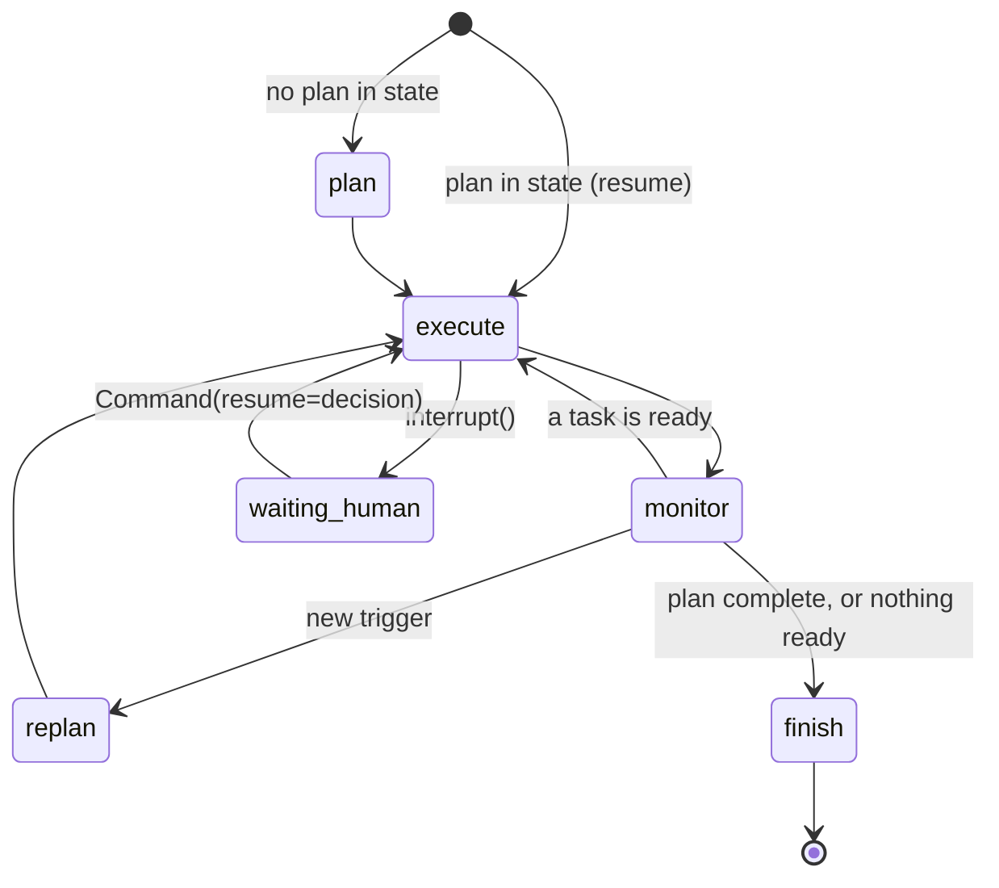

# SiteMind architecture

This document describes how a run is planned, executed, checkpointed, re-planned and resumed.
For data shapes see `backend/sitemind/models.py`; for specialist behaviour and the demo
numbers see [`SPECIALISTS.md`](SPECIALISTS.md); for the cross-team contract see
[`CONTRACT.md`](CONTRACT.md).

## 1. Processes and storage

| Component | Where | Role |
|---|---|---|
| API | `sitemind.api:app` (FastAPI, port 8000) | REST for the dashboard; creates runs, records approval decisions, spawns and kills workers; serves `frontend/dist` |
| Worker | `python -m sitemind.runner <run_id> [--resume-value JSON]` | One OS process per active run. Builds the graph and invokes it from the latest checkpoint until the run finishes or waits for a human. Holds a per-run file lock (`$SITEMIND_DATA/locks/<run_id>.lock`) so two workers never drive one run. |
| Checkpoint DB | `$SITEMIND_DATA/checkpoints.sqlite` | LangGraph `SqliteSaver`, WAL, `thread_id = run_id` |
| App DB | `$SITEMIND_DATA/sitemind.sqlite` | WAL; tables `runs`, `audit`, `ledger`, `approvals`, `timeline`, `snapshot`, `outbox` |
| MCP server | `python -m sitemind.mcp_server` | Stateless; exposes the specialists to other agents |
| LLM | Ollama, `qwen2.5:3b` | Wording only; every call cached in the ledger |

The API and the worker share nothing in memory. Everything the dashboard shows is read from
the two SQLite files, which is why killing the worker loses nothing.

## 2. Graph state machine

`graph.build_graph()` compiles a five-node `StateGraph`:



| Node | What it does | Side effects (all ledgered) |
|---|---|---|
| `plan` | `planner.make_plan(goal, REGISTRY, now)` builds plan v1: 14 tasks, backward-scheduled deadlines, 5 base risks | LLM call `plan-v1:llm:rationale` |
| `execute` | Takes the first ready task in topological order, dispatches on its action to a handler, advances simulated time by the task's duration, writes one audit entry | whatever the handler does (see section 4) |
| `monitor` | `detect_triggers(plan, facts)` compares facts with the plan and emits triggers not already handled | none |
| `replan` | `planner.replan(plan, triggers, facts, now)` produces plan `version + 1` | LLM call `plan-v<n>:llm:replan` |
| `finish` | Marks the run completed and writes the closing audit entry | none |

Checkpointed state (`RunState`): the current plan, `plan_history`, `facts` (takeoff, quotes,
attempts, schedules, budget checks, memo, PO, selections), `sim_now`, `last_task`, the
pending `triggers` and the set of `handled` triggers.

**One task per super-step.** `execute` runs exactly one plan task and returns. LangGraph
persists a checkpoint after each super-step, so the granularity of recovery is one task.

### Run and task status

| Run status | Meaning |
|---|---|
| `created` | row exists, no worker yet |
| `running` | a worker is driving the graph |
| `waiting_human` | the graph is parked on `interrupt()` and the worker has exited |
| `killed` | the worker died or was SIGKILLed; resumable |
| `completed` / `failed` | terminal |

Task status: `pending`, `ready`, `running`, `waiting_human`, `done`, `failed`, `skipped`
(superseded by a re-plan).

## 3. Plan structure and versioning

Task ids are `T<n>-<action>[-<vendor>]`. The graph dispatches on `<action>`.

Plan v1 for three vendors:

```
T1-takeoff
  └─ T2-rfq
       └─ T3-levelling
            ├─ T4-schedule-V1   T5-schedule-V2   T6-schedule-V3
            └─ T7-budget-V1     T8-budget-V2     T9-budget-V3
                 └─ T10-rank
                      └─ T11-approve-vendor   (human)
                           └─ T12-draft-po
                                └─ T13-approve-po   (human)
                                     └─ T14-send-po
```

| Action | Specialist | Meaning |
|---|---|---|
| `takeoff` | takeoff | read the spec PDF into a bill of quantities |
| `rfq` | quotes | RFQ to every vendor, up to 3 attempts each |
| `levelling` | quotes | refresh and confirm each quote before evaluation |
| `schedule-<V>` | schedule | CPM schedule for vendor V against the required-on-site date |
| `budget-<V>` | budget | quote + 5 % contingency + fees against the ceiling |
| `rank` | approvals | rank options, write the decision memo |
| `approve-vendor` | approvals | human approval: vendor selection |
| `draft-po` | po | draft the PO package |
| `approve-po` | approvals | human approval: PO release |
| `send-po` | po | transmit the PO |
| `negotiate-<V>` | quotes | re-plan only: re-quote a revised price |
| `expedite-<V>` | schedule | re-plan only: evaluate V's expedite offer |
| `chase-<V>` | quotes | re-plan only: final chase of a silent vendor, then exclude |
| `escalate` | approvals | re-plan only: notify the project manager of the trade-off |

### Re-plan rules

`replan()` copies the plan, increments `version`, and applies these rules. Tasks that are
`done` stay done. Pending tasks that no longer apply become `skipped` with a note naming the
plan version that superseded them. New tasks continue the `T<n>` numbering and carry
`plan_version`. Every version is kept in `plan_history`.

| Trigger | Raised when | Plan change |
|---|---|---|
| `budget_breach:<V>` | V's quote is `revised` and its budget verdict is `breach` | add `negotiate-<V>`; add a new `rank` and an `escalate`; skip the old `rank`; re-wire `approve-vendor` to depend on `escalate`; add risk R6 |
| `deadline_break:<V>` | no option within budget has at least 14 days of float, V is late, V has an expedite offer and is within budget | add `expedite-<V>` (allowance = the fee); new `rank` + `escalate`; add risk R7 |
| `vendor_unresponsive:<V>` | V's quote is still `timeout` after all attempts | add `chase-<V>`; new `rank` + `escalate` |
| `approval_rejected:<task>` | a human rejects a vendor selection or a PO release | mark that approval `failed`; skip its pending descendants; add a new `rank` + `approve-vendor` (or `draft-po` + `approve-po`) and re-create the downstream chain |

Triggers on quotes are only evaluated once all schedule and budget checks for the current plan
are finished and a `rank` is still pending, so the agent re-plans on a complete picture
instead of on the first bad number. A trigger that has been handled is recorded and not raised
again.

In the demo scenario two triggers fire together after the budget checks: `budget_breach:V2`
(revision 2 puts V2 at 100.8 % of budget) and `deadline_break:V3` (no in-budget option has
14 days of float, and V3 has an expedite offer). Plan v2 adds 4 tasks and supersedes 1:

```
T15-negotiate-V2   V2 holds its price; still a breach
T16-expedite-V3    Anvil expedite: −42 d for ₹26,00,000
T17-rank           re-rank, rewrite the decision memo      (T10-rank -> skipped)
T18-escalate       notify the project manager
T11-approve-vendor now depends on T18-escalate
```

## 4. Durability and idempotency

### The ledger

```sql
CREATE TABLE ledger (
    idempotency_key TEXT PRIMARY KEY,   -- {run_id}:{task_id}:{action}:{discriminator}
    run_id TEXT NOT NULL,
    kind TEXT NOT NULL,                 -- rfq.sent, quote.refresh, quote.negotiate, notify.pm,
                                        -- approval.requested, po.sent, llm.call, ...
    status TEXT NOT NULL,               -- pending | done
    owner_pid INTEGER,                  -- process that claimed the key
    payload TEXT NOT NULL DEFAULT '{}',
    result TEXT NOT NULL DEFAULT '{}',
    sim_time TEXT NOT NULL,
    wall_time TEXT NOT NULL,
    executions INTEGER NOT NULL DEFAULT 1,   -- times requested; executed once
    seq INTEGER
);
```

`Store.perform_once(key, kind, payload, fn)` runs inside `BEGIN IMMEDIATE`:

| State of the key | Behaviour |
|---|---|
| absent | insert as `pending` with this pid, run `fn` outside the write lock, store the result, mark `done` |
| `done` | increment `executions`, return the stored result; `fn` is not called |
| `pending`, owner alive | wait and poll until the owner finishes, then return its result |
| `pending`, owner dead (killed mid-call) | take the claim over, increment `executions`, run `fn` |
| `fn` raises | delete the pending row so a later attempt can retry |

Example keys:

| Key | Action |
|---|---|
| `<run>:T2-rfq:rfq:V1:a1` | RFQ to V1, attempt 1 |
| `<run>:T3-levelling:refresh:V2:r1` | refresh V2's revision-1 quote |
| `<run>:T15-negotiate-V2:negotiate:V2:r2` | negotiation message to V2 |
| `<run>:T16-expedite-V3:expedite:V3` | expedite offer confirmation |
| `<run>:T18-escalate:notify:pm` | escalation notice to the project manager |
| `<run>:T11-approve-vendor:approval:requested` | approval request created |
| `<run>:T14-send-po:po:<po_number>` | PO transmission |
| `<run>:plan-v1:llm:rationale` | cached model output |

### What a restart does

1. `POST /api/runs/{id}/kill` sends SIGKILL to the worker pid. The run status becomes `killed`
   and a `kill` timeline event and audit entry are written by the API process.
2. `POST /api/runs/{id}/resume` spawns a new worker. It opens the checkpointer and invokes the
   graph with no new input, so LangGraph continues from the last checkpoint.
3. The task that was in flight is replayed from its start. Specialists are pure, so it
   recomputes the same values. Each side effect hits the ledger: completed ones return the
   stored result and their `executions` goes to 2.
4. Audit and timeline rows are inserted with a deterministic `dedupe_key` (`UNIQUE`), so the
   replay does not add duplicates.
5. Simulated time is taken from the checkpointed state, so the replay is stamped with the same
   instants.

Stated guarantee: an action recorded as `done` is never executed again. An action interrupted
between its external effect and the `done` write is executed again on resume; the `outbox`
row carries the same idempotency key so that a real receiving system can deduplicate.

### Human approvals

1. The handler creates the `ApprovalRequest` row through `perform_once` (id
   `<run_id>:<task_id>`), sets the run to `waiting_human`, and calls `interrupt()`.
2. The worker returns and exits. No process is running while the agent waits.
3. `POST /api/runs/{id}/approvals/{approval_id}` stores the `ApprovalDecision` and spawns a
   worker with `Command(resume=decision)`.
4. The handler records the decision, advances simulated time by the scripted human turnaround
   (4 days for vendor selection, 2 for PO release), and continues or fails the task.

### Simulated clock

`SimClock` persists `sim_now` on the `runs` row. Each task has a fixed simulated duration
(for example takeoff 0.5 d, each RFQ attempt window 2 d, levelling 3 d, negotiation 4 d).
The graph computes the new time from the checkpointed `sim_now`, never from the wall clock.
`SITEMIND_STEP_DELAY` adds wall-clock pacing so a person can watch the run.

## 5. Failure handling matrix

| Failure | Detected by | Automatic response | Escalation |
|---|---|---|---|
| Vendor does not answer an RFQ | `VendorTimeout` in `collect_quotes` | retry, up to 3 attempts, each attempt a separate ledger key and audit entry | after 3 timeouts the quote is a `timeout` placeholder, ranking skips it, `vendor_unresponsive` adds a final chase and the remaining vendors carry the decision |
| Price revised after the quote | `levelling` refresh returns revision 2 | budget re-checked for that vendor | if the verdict is `breach`: re-plan (negotiate, re-rank) and `escalate` to the PM with the memo |
| Lead time breaks the on-site date | CPM `float_days < 0` | option marked infeasible; expedited variant `O-<V>X` ranked alongside | if no in-budget option keeps 14 days of float: `deadline_break` re-plan evaluates the expedite offer, then escalates |
| Takeoff disagrees with the drawing | schedule quantity vs drawing label count | schedule quantity used, confidence reduced, warning recommends an RFI | warning appears in the audit entry and the memo context |
| Human rejects a vendor or a PO | approval decision `reject` | `approval_rejected` re-plan: re-rank excluding the rejected option, or re-draft the PO | new approval request |
| Worker crashes or is killed | API sees the pid is dead; status `killed` | resume from the last checkpoint; ledger prevents repeats | none needed |
| Two workers started for one run | per-run `flock` | the second worker exits | none |
| LLM unreachable or times out | exception in `llm.py` | deterministic template; audit records `provider: "fallback"` | none; numbers are unaffected |
| Task finishes after its deadline | `execute` compares finish date with `task.deadline` | `deadline.missed` audit entry and timeline warning | visible to the PM in the trail |

## 6. Audit, timeline and outbox

```sql
CREATE TABLE audit (
    seq INTEGER PRIMARY KEY AUTOINCREMENT,
    run_id TEXT NOT NULL,
    dedupe_key TEXT UNIQUE,      -- makes replays idempotent
    sim_time TEXT NOT NULL,
    wall_time TEXT NOT NULL,
    actor TEXT NOT NULL,         -- planner, takeoff, quotes, schedule, budget, approvals, po,
                                 -- monitor, human, system
    action TEXT NOT NULL,        -- plan.created, task.done, trigger.detected, escalation,
                                 -- approval.requested, approval.approved, deadline.missed, ...
    summary TEXT NOT NULL,       -- one or two sentences of reasoning
    inputs TEXT NOT NULL DEFAULT '{}',
    outputs TEXT NOT NULL DEFAULT '{}',
    cost_inr REAL NOT NULL DEFAULT 0,
    llm_tokens INTEGER NOT NULL DEFAULT 0,
    confidence REAL,
    task_id TEXT,
    plan_version INTEGER
);

CREATE TABLE outbox (            -- messages actually delivered to the mock vendors / PM
    id INTEGER PRIMARY KEY AUTOINCREMENT,
    run_id TEXT NOT NULL,
    channel TEXT NOT NULL,       -- rfq, refresh, negotiate, email, po
    vendor_id TEXT NOT NULL,
    ref TEXT NOT NULL,
    idempotency_key TEXT NOT NULL,
    payload TEXT NOT NULL,
    sim_time TEXT NOT NULL,
    wall_time TEXT NOT NULL,
    sender_pid INTEGER
);
```

`timeline` holds the lane events drawn on the dashboard (`lane`, `label`, `kind`), also with a
unique dedupe key. `approvals` stores each `ApprovalRequest` as JSON. `snapshot` is a
projection of the checkpointed state written by the worker so the API can answer
`GET /api/runs/{id}` without opening the checkpoint DB.

The `outbox` is the independent check on the ledger: one row per message with the pid that
sent it. After a kill and resume, the number of `rfq` rows per vendor and attempt is 1 and the
number of `po` rows is 1.

A reference run (`python -m sitemind.cli demo --provider off --kill-after 12`) ends with plan
v2, 18 tasks (17 done, 1 skipped), 39 checkpoints, 36 audit entries, 17 ledger keys and 1
worker restart. The two `approval.requested` keys show `executions = 2`: each was requested
once before `interrupt()` and once more when the node re-entered on resume, and the approval
row was created once.

## 7. Where the LLM sits

The model is called in four places: plan rationale and risk mitigations, re-plan explanation,
and decision-memo prose. Each call:

- uses temperature 0 and a short token limit;
- requests schema-constrained JSON through pydantic-ai where structure is needed;
- is wrapped in `perform_once` under `{run_id}:{scope}:llm:{purpose}`, so a resume returns the
  stored text;
- has a deterministic fallback string, used on any error or timeout.

Quantities, prices, dates, float, utilisation, scores and verdicts are computed by the
specialists. Setting `SITEMIND_LLM_PROVIDER=off` changes wording and nothing else.

## 8. Design influences

No code was copied from the projects below; licences are listed in [`../CREDITS.md`](../CREDITS.md).

**bytedance/deer-flow (long-horizon agent harness).** Three ideas carried over:

- *Separation of roles.* deer-flow separates the planner from the workers that research and
  the reporter that writes up. SiteMind has the same split: `planner.py` owns the plan and its
  versions, the specialists do the work, and the approvals specialist writes the report a human
  reads (the decision memo).
- *The plan is data.* The plan is a stored, versioned object that the harness walks, so a step
  that invalidates the plan produces a new version instead of an improvised detour.
- *Durable memory outside the model.* Run state lives in checkpoints and tables. The model has
  no memory to lose on restart.

SiteMind differs in one respect: plan structure is produced by deterministic code with the
model wording it, because a 3B local model is not reliable enough to emit a valid DAG.

**DDC Skills for AI Agents in Construction.** The decomposition of procurement into
estimation/takeoff, scheduling by critical path, budget control and document generation, and
the vocabulary used for task names, follow the skill breakdown in that collection. Each
SiteMind specialist is declared the way a skill is: a name, a description, what it takes and
what it returns (`SpecialistSpec`).

**OpenTakeoff.** The takeoff is a tool an agent calls over MCP, each line records its source
(document, page, table, row), and agent output remains a proposal until a person accepts it.
